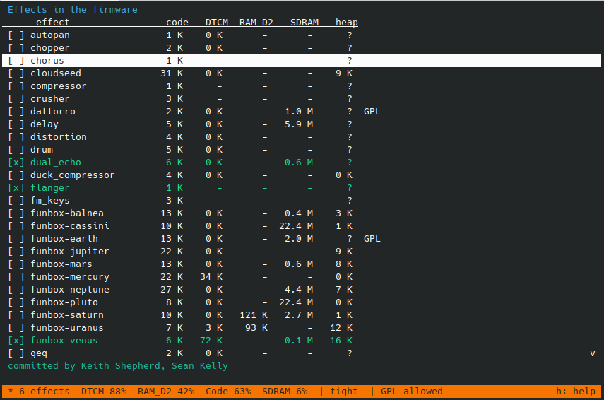

# Generating the firmware

Which effects go into the firmware, and in which order, is chosen with the effect selection tool, started with the shell script **`./effects_config.sh`** (Python 3, no packages needed; run it from this directory, any arguments are passed on to the tool). The result is stored in `effects.config`, and the tool generates the files the build needs from it, so `loaded_effects.h` and the `Makefile` are not edited by hand. This document describes the tool, the limits a selection has to stay within, and how to combine effects into chains. For the toolchain, the hardware variant and flashing, see [README.md](README.md#getting-started).

The basic steps:

1. Run `./effects_config.sh` and select the effects (arrows to move, space to select, `s` to save, `h` for help), or start from a preset (`./effects_config.sh preset <name>`).
2. Build as described in [README.md](README.md#4-build-and-deploy-the-code). `make` regenerates the generated files by itself when `effects.config` or `effects.json` has changed.
3. Flash the firmware. Enabling, disabling or reordering effects changes the layout of the saved settings, which are reset on the next boot.


## The effect selection tool

Running `./effects_config.sh` without arguments brings up a full-screen tool in the terminal, where the effects are listed with what each costs in memory and the status bar shows whether the selection fits and can be built. This is the easiest way to choose the effects.



The selection is kept in **`effects.config`**. The tool also generates what depends on the choice:
`generated/effects.mk` (the sources, and the sources and defines of what the chosen effects need, which the `Makefile` includes) and the effect list that `loaded_effects.h` includes.
`make` regenerates them by itself when `effects.config` changes, so after editing the file (or running one of these) just build:

```text
./effects_config.sh                           # the interactive full-screen selection (curses): arrows to move, space to select, s to save, h for help
./effects_config.sh observe "boots and runs" --heap-used 120 --heap-free 136   # record what the pedal showed (Show Debug) for the current selection
./effects_config.sh lint                      # parameter names and choices that are too long for the big font (the display draws them smaller; over 22 characters they would be cut)
./effects_config.sh info funbox-uranus               # what is known about an effect: origin, copyright lines in its source, who committed it, memory (key i in the interactive mode)
./effects_config.sh list                      # all effects, what is enabled, and what each costs in memory
./effects_config.sh preset uranus-only        # start from a preset (configs/*.config; "everything" enables all effects)
./effects_config.sh enable funbox-venus funbox-saturn       # enable effects (disable does the opposite)
./effects_config.sh report                    # how much of DTCM, RAM_D2 (static data + heap), code space and SDRAM the current selection needs
./effects_config.sh matrix funbox-venus funbox-jupiter ...  # the same for every combination of the named effects
```

Only the chosen effects are compiled and linked, which matters for memory: global buffers in an object file can stay in the firmware even if nothing uses them. **Not every selection boots**: the pedal's
heap (in RAM_D2) is small and unchecked, so too many large effects lock it up at start. `report` and `matrix` estimate that (and show what has been tried on the pedal); the details are in
[`PERFORMANCE_AND_MEMORY.md`](PERFORMANCE_AND_MEMORY.md). The order of the enabled effects (the order in `effects.json`) is the order in the menu and decides the layout of the saved settings, so enabling or disabling an effect
resets the saved settings on the next boot. To add an effect, add it to `effects.json` (sources, header, class, what it needs); `effects_config.sh measure` and `calibrate` update its memory figures after a build.

## Optional: Dattorro plate reverb (GPLv3)

`Effect-Modules/Dattorro/` contains a Dattorro (1997) plate reverb, in the same family used by
the Hothouse "Flick" and "MuleBox" pedals. It's disabled by default (not in any preset, and the tool refuses it without `ALLOW_GPL=y`), because that code is licensed **GPL-3.0-or-later**, not MIT
like the rest of this repository — see [`Effect-Modules/Dattorro/README.md`](Effect-Modules/Dattorro/README.md)
for the full provenance chain and license text. Enabling it means the firmware binary you build
must be distributed under GPLv3 (or not distributed at all); leaving it out keeps your
build entirely MIT.

To opt in: set `ALLOW_GPL=y` in `effects.config` (the tool refuses to build them otherwise), enable `dattorro` (and `funbox-earth`, which is built on it) with `./effects_config.sh enable dattorro funbox-earth`, then rebuild and flash.

## Memory notes for the tool

* **Only the chosen effects are compiled**, which also stops unused global buffers from taking memory: an object file with an explicitly placed buffer, like Saturn's in `.sram_d2_bss`, keeps all of that section even when nothing uses it. `list`, `report` and `matrix` show the memory budget; `measure` and `calibrate` refresh `effects-memory.json` from the last build
  (to measure every effect: `preset everything`, `make -k`, `measure`, then `preset` the real selection and build, `calibrate`). The CloudSeed pool's size follows the number of effects that use the engine
  (`-DCLOUDSEED_ENGINES`, 7.1 / 12.6 / 19.7 MB).
* **Defines and stale objects:** the selection sets some compiler defines (`-DCLOUDSEED_ENGINES` for the size of the SDRAM pool, the CMSIS table defines for Venus and Saturn). make cannot see that a define changed, so a firmware built after adding a second CloudSeed effect still had the pool of one engine (7.1 MB where two need 9.8 MB):
  the second engine's allocation failed and the pedal froze at boot (this is what happened with Jupiter + Neptune). The defines are now in `generated/defines.mk`, which every object file depends on, so a changed define rebuilds everything (and the pool reports `OUT OF MEMORY: CloudSeed pool full` instead of freezing, should it ever be too small).

## Adding and testing effects

Every converted effect has an entry in `effects.json` (what to compile, what it needs: `impulse_response` for Mars, the CloudSeed pool for Jupiter and Neptune, the CMSIS FFT tables for Venus and Saturn) and its memory figures in `effects-memory.json`; **a new effect needs an entry in both.**

## Combining Effects (EffectChain)

Chains can be made without writing any C++: in the interactive tool (`./effects_config.sh`) press `c`, make a chain, add its effects, and map their parameters to knobs and MIDI CCs.
They are stored in `chains.json`, and `effects_config.sh generate` (or `s` in the tool, or `make`) turns them into `generated/effects_chains.inc`, which `loaded_effects.h` includes. The effects
of a chain are built even if they are not selected on their own (`[c]` in the list). The tool checks what `effect_chain.cpp` warns about: effects on the CloudSeed engine cannot be chained, and an effect that keeps big buffers
can exist only once (not also on its own, not in two chains). The rest of this section describes the C++ the tool writes, which you can still write by hand in `loaded_effects.h`.

`Effect-Modules/effect_chain.h` lets you wire two or more effects into a single chained entry in
`loaded_effects.h`, processed serially (e.g. tremolo into reverb), without changing any of the
effect modules themselves or the menu/UI code. For example:

```cpp
new EffectChain(
    "Trem+Verb",
    // Slots: a short menu tag plus the child effect instance (owned by the chain).
    {{"Tr", new ModulatedTremoloModule()}, {"Rv", new ReverbModule()}},
    // Knob/MIDI CC mappings: {slot, child param id, knob (-1 = none), midi CC (-1 = none)}.
    {{0, ModulatedTremoloModule::DEPTH, 0, 20},
     {0, ModulatedTremoloModule::FREQ, 1, 21},
     {1, ReverbModule::TIME, 2, 22},
     {1, ReverbModule::DAMP, 3, 23},
     {1, ReverbModule::MIX, 4, 24}}),
```

Every child parameter shows up in the effect's parameter menu, tagged with its slot's prefix (e.g.
"Tr Depth", "Rv Mix") so identically-named parameters from different children stay distinct; only
the parameters listed in the mapping array are reachable from a knob and/or MIDI CC. One slot (the
first, by default) is the "primary" child, which owns the LED and the alternate footswitch.

Every slot also gets its own "\<tag\> On" checkbox in the menu, defaulting to on, so any slot can be
bypassed independently. This is saved with presets exactly like any other parameter.

By default the alternate footswitch just forwards to the primary child (e.g. for tap tempo).
Pass `footswitchTogglesSlots` to repurpose it as an on-off slot for one or more children, e.g.:

```cpp
new EffectChain(
    "HT+Dly+Rv",
    {{"Tr", new HarmonicTremoloModule()}, {"Dl", new DelayModule()}, {"Rv", new DattorroReverbModule()}},
    {{2, DattorroReverbModule::MIX,    0, 20},
     {0, HarmonicTremoloModule::DEPTH, 1, 21},
     {0, HarmonicTremoloModule::SPEED, 2, 22},
     {1, DelayModule::DELAY_TIME,      3, 23},
     {1, DelayModule::D_FEEDBACK,      4, 24},
     {1, DelayModule::DELAY_MIX,       5, 25}},
    /* primarySlot */ 1,
    /* footswitchTogglesSlots */ {0}), // or {0,1} to toggle trem+delay together
```

A `ChainMapping` can also target a slot's own "On" parameter instead of a child parameter, using the
`EffectChain::SLOT_ENABLE` sentinel (e.g. `{0, EffectChain::SLOT_ENABLE, -1, 30}`), which puts that
bypass on a MIDI CC regardless of whether the footswitch is also toggling it.

Turning a slot off crossfades it out over about a tenth of a second and then stops processing it
entirely, both to avoid a click and to save CPU. Note the delay/reverb trails are not preserved.

If you want to have more than six physical knobs, give any `ChainMapping` a `knobMapping` of 6 or
higher, and that parameter moves to a second knob bank instead of being unreachable: holding the alternate
footswitch for a second toggles between the two banks (an on-screen "SHIFT" label shows when the
second bank is active), and holding it again switches back. Physical knob 1 reads whatever's mapped
to knob 0 normally, and whatever's mapped to knob 6 while shifted; knob 2 maps to 1/7, and so on
through knob 6 mapping to 5/11. This only kicks in when a chain actually uses a `knobMapping` of 6 or
higher somewhere — with every mapping in 0-5, holding the footswitch keeps forwarding to the primary
child (or stays a no-op under `footswitchTogglesSlots`) exactly as before:

```cpp
new EffectChain(
    "HT+Dly+Rv",
    {{"Tr", new HarmonicTremoloModule()}, {"Dl", new DelayModule()}, {"Rv", new DattorroReverbModule()}},
    {{2, DattorroReverbModule::MIX,       0, 20},
     {0, HarmonicTremoloModule::DEPTH,    1, 21},
     {0, HarmonicTremoloModule::SPEED,    2, 22},
     {1, DelayModule::DELAY_TIME,         3, 23},
     {1, DelayModule::D_FEEDBACK,         4, 24},
     {1, DelayModule::DELAY_MIX,          5, 25},
     // Shift bank - reachable by holding the alternate footswitch for 1s.
     {2, DattorroReverbModule::PRE_DELAY, 6, 26},
     {2, DattorroReverbModule::DECAY,     7, 27},
     {2, DattorroReverbModule::TONE,      8, 28},
     {2, DattorroReverbModule::DIFFUSE,   9, 29},
     {1, DelayModule::DELAY_LPF,          10, 30},
     {1, DelayModule::MOD_AMT,            11, 31}},
    /* primarySlot */ 1,
    /* footswitchTogglesSlots */ {0}),
```

This isn't meant to support every combination of effects — some modules need caution, or are a poor
fit for chaining altogether:

- **Single-instance-only modules.** Many modules that keep DSP buffers or other resources in a file-scope
  global, where every *instance* of that class aliases the same memory. In practice this means you can
  only create one instance. You can*use* the one instance more than once, e.g. in more than one effect
  chain or in a combination of an effect chain and a standalone effect, but since they share their
  parameters, any changes when viewing one patch affects all references.
  
  Modules in this category: `ReverbModule`, `DattorroReverbModule`, `DelayModule`, `TapeDelayModule`,
  `MultiDelayModule`, `GranularDelayModule`, `SpectralDelayModule`, `SciFiModule`,
  `PitchShifterModule`, `LooperModule`, `PluckEchoModule`, `NamA2Module`, `CloudSeedModule`,
  `TunerModule`.
- **Custom on-screen displays are lost.** A chain always draws its own generic name/parameter screen
  instead of forwarding to a child's `DrawUI`, so these modules lose some or all of their custom
  display when chained: `AutoPanModule`, `ChopperModule`, `DelayModule`, `GraphicEQModule`,
  `LooperModule`, `MetroModule`, `ParametricEQModule`, `PitchShifterModule`, `TapeDelayModule`,
  `TunerModule`. This doesn't stop them working, but it can be confusing.

### Sharing a single-instance effect between chains

A single-instance-only module (see above) can still show up in more than one chain, as long as
it's the same object every time. Construct it once, put it in every `ChainSlot` that wants it, and
mark every slot but one `ownsEffect = false` so only one of them deletes it:

```cpp
static DattorroReverbModule* reverb = new DattorroReverbModule();

new EffectChain("HarmTremVerb",    {{"HT", new HarmonicTremoloModule()}, {"Rv", reverb}}, ...),                    // owns it
new EffectChain("ModTremVerb", {{"Tr", new ModulatedTremoloModule()}, {"Rv", reverb, /* ownsEffect */ false}}, ...), // reuses it
```

The two chains are then processing the exact same reverb - its parameters are shared state, not a
copy per chain. Switching between the chains never resets or overwrites the other's settings by
itself; only turning that shared knob, editing it in the menu, or a MIDI CC actually changes it. The
one gap is at power-on: every chain restores its own saved values into whatever it maps parameters
to, so whichever chain happens to come later in `effectList` decides the shared effect's values after
a reboot - not necessarily the chain you had active when you last powered off.
